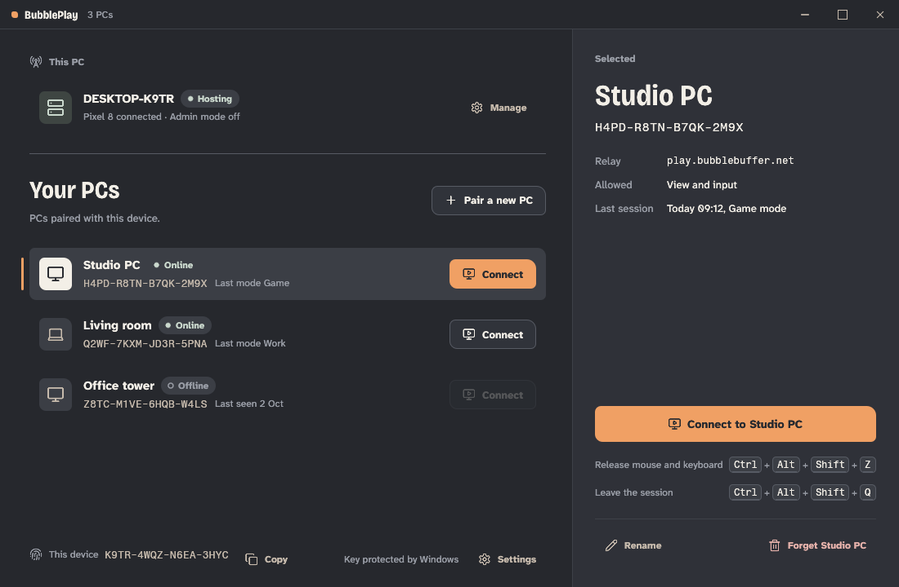
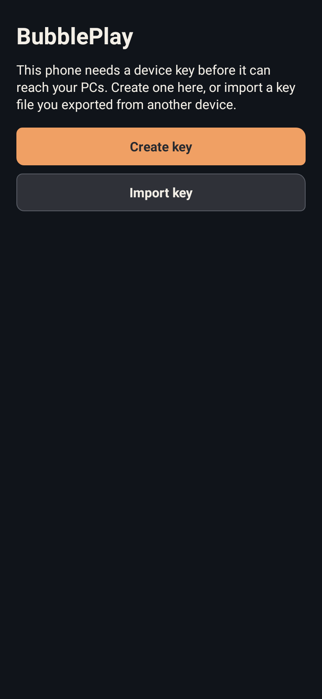
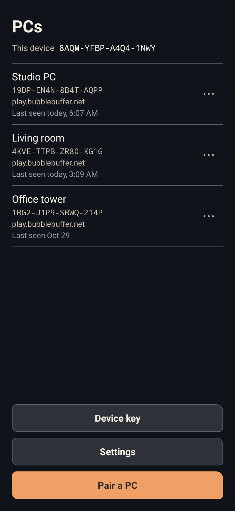
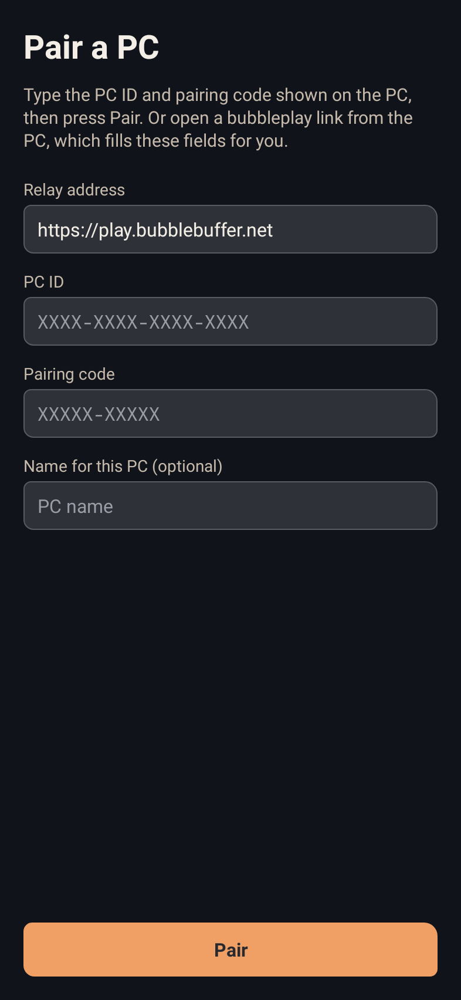
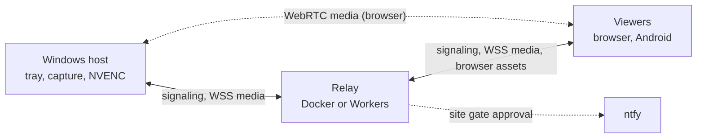

<p align="center">
  <picture>
    <source media="(prefers-color-scheme: dark)" srcset="design/readme/bubbleplay-dark.svg">
    
  </picture>
</p>

<p align="center">Stream your Windows desktop to a browser, with native cursor shapes, keyboard and mouse input, clipboard sharing, and file transfer. Use WebRTC or WebSocket streaming through your own relay.</p>

BubblePlay is being prepared for its first open-source alpha under the GNU Affero General Public License v3.0 or later (AGPL-3.0-or-later). The current Windows/browser path works. You run your own relay: the Rust relay in a Docker container, or on Cloudflare Workers ([relay setup](relay-rs/README.md)). A new browser must be approved through an ntfy notification ([site gate](docs/architecture/device-keys.md#site-gate)); it then unlocks or creates a device key and picks your PC ([browser viewer](docs/browser-viewer.md)). The public GitHub release is still pending.

<p align="center">
  
</p>

## What it is

- **Windows host.** A per-user tray app and host capture the desktop with DXGI and encode it with NVENC, falling back to a Media Foundation encoder. It runs as the signed-in user; an optional elevated helper enables input in elevated applications, and a SYSTEM helper captures UAC prompts and the lock screen.
- **WebRTC or WebSocket media.** Video goes over WebRTC (str0m on the host), directly or through a configured TURN server, or over a TLS WebSocket through the relay. Android uses the WebSocket path.
- **Your own relay.** The relay is one Rust codebase (`relay-rs`): an axum server you run in Docker, or a Cloudflare Workers build with a Durable Object. It handles signaling and serves the browser viewer.
- **Device keys, no passwords.** Every viewer holds a device key and proves it to the relay; a PC accepts a device only after pairing. Control, input and clipboard messages are encrypted end to end between viewer and PC. A new browser is held at a silent site gate until you approve it through an ntfy notification.
- **Viewers.** A browser viewer for desktop Chromium and a native Android app; Android device acceptance is pending. A native Windows client is in development and still runs on a mock backend.
- **Desktop interaction.** Native cursor shapes, keyboard and mouse input, text and image clipboard sharing, uploads to the PC, and downloads of files the PC offers.

<p align="center">
  
  &nbsp;
  
  &nbsp;
  
</p>

## Get started

The Windows host currently requires **Windows x64, an NVIDIA GPU and its display driver**. Use a desktop Chromium browser as the receiver. The host runs as the signed-in Windows user; an optional elevated helper enables input in elevated applications.

- [Windows installation and first connection](docs/windows-quickstart.md)
- [Relay setup (Docker and Cloudflare Workers)](relay-rs/README.md)
- [Documentation](docs/README.md)
- [Build and development checks](docs/development.md)
- [Architecture and feature contracts](docs/architecture/README.md)
- [Android client](android/README.md)

Docker runs the site gate and relay ([relay-rs/Dockerfile](relay-rs/Dockerfile)). Desktop capture and encoding run on the native Windows host. The Rust relay has automated protocol and gate tests; live Docker and desktop-stream acceptance remain pending.

See [release status](docs/release-status.md) for the remaining acceptance checks. Contributors can start with the [repository map and checks](docs/development.md).

## How it fits together



| Part | Path | What it is |
| --- | --- | --- |
| bubbleplay-host | [`host/`](host) | BubblePlay streaming host: DXGI capture, NVENC, str0m WebRTC, input, clipboard, files and the tray |
| bp-relay-core | [`relay-rs/core/`](relay-rs/core) | Sans-IO protocol validation, wire size limits and routing state machine for the relay |
| bp-relay-server | [`relay-rs/server/`](relay-rs/server) | Native axum and tokio shell of the relay: config, state files, subcommands, static assets |
| bp-relay-worker | [`relay-rs/worker/`](relay-rs/worker) | Cloudflare Workers adapter: a Durable Object driving the relay core over hibernating WebSockets |
| bp-device-key | [`crates/bp-device-key/`](crates/bp-device-key) | Device-key primitives: device IDs, relay proofs and the key file, encrypted when it has a passphrase |
| Browser viewer | [`worker/public/`](worker/public) | Browser receiver served by the relay, with no frontend bundler |
| bubbleplay-client | [`client-win/`](client-win) | Native Windows viewer, in development (UI on a mock backend) |
| Android app | [`android/`](android) | Native Kotlin receiver, gestures, codec and APK build |

## Desktop interaction

The browser translates Windows cursor types into native local cursors. Clipboard sharing supports text and images, subject to browser permissions. Drag files onto a compatible remote Windows application to supply virtual files, or use the Files menu to upload them into `Downloads\BubblePlay`. Mobile interaction has its own client and validation scope.

Remote input acts with the permissions of the Windows user. Secure desktops, including lock screens and UAC prompts, are captured by a SYSTEM helper; live acceptance is pending. AMD, Intel and software encoding have not been demonstrated. The first Windows package is unsigned.

## Privacy

TLS protects each WebSocket connection. A WebSocket relay can read video and file payloads, so run it on infrastructure you trust; control, input and clipboard messages are encrypted end to end. WebRTC media uses its own encrypted transport. See [security and privacy](docs/security-and-privacy.md) for authentication and platform boundaries.

Private command-execution companion components are excluded from the public relay and Windows package. The optional Windows admin-input helper has a separate, limited purpose.

## Build

CI pins Rust 1.97.1, Node 22 and 24, and Temurin JDK 17. The commands below are the ones it runs, from the repository root.

```sh
# Relay
(cd relay-rs && cargo test --locked --workspace --no-fail-fast)
(cd relay-rs && cargo check --locked -p bp-relay-core --target wasm32-unknown-unknown)
docker build -f relay-rs/Dockerfile .

# Browser viewer and repository checks
node tools/check.mjs client
node --test tools/tests/*.test.mjs

# Windows host and client (Windows x64)
cargo fetch --locked --manifest-path host/Cargo.toml
node tools/check.mjs host
cargo clippy --locked --offline --manifest-path host/Cargo.toml --all-targets -- -D warnings
cargo test --locked --offline --manifest-path client-win/Cargo.toml

# Android (Gradle 8.14.3 wrapper, AGP 8.13.0, Kotlin 2.2.21, compileSdk 35)
(cd android && bash ./gradlew --no-daemon testDebugUnitTest lintDebug)
(cd android && bash ./gradlew --no-daemon assembleRelease)
```

The Cloudflare Workers build uses `worker-build` 0.8.7 and `wrangler` 4.148.0. See [development](docs/development.md) for the full checks and release packaging.

## Licence

BubblePlay is licensed under the [GNU Affero General Public License v3.0 or later](LICENSE) (`AGPL-3.0-or-later`). If you run a modified relay or host for other people, you must offer them its source. Third-party components retain their own licenses; see [dependency notices](docs/THIRD-PARTY-NOTICES.md).

BubblePlay is made by [BubbleBuffer](https://0xbubbuff.de).
